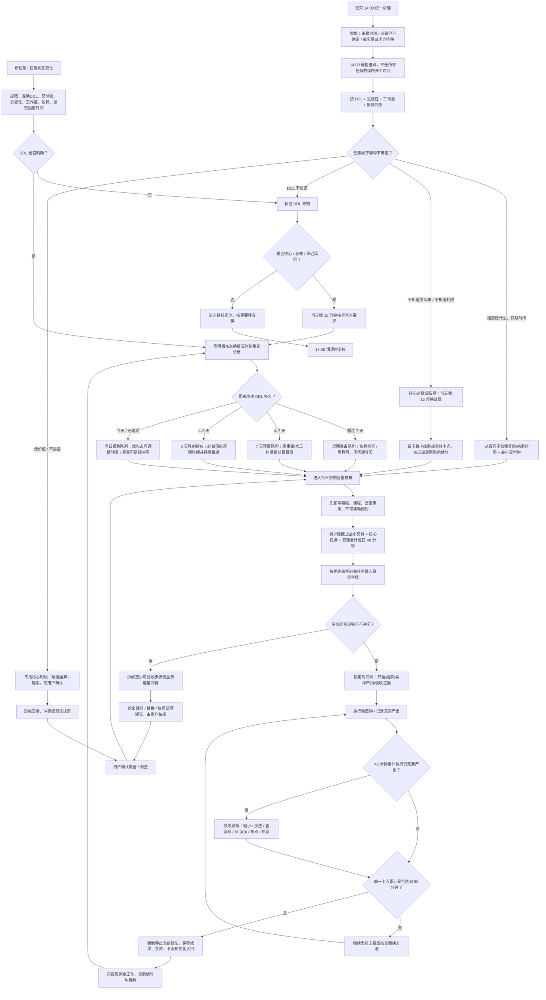
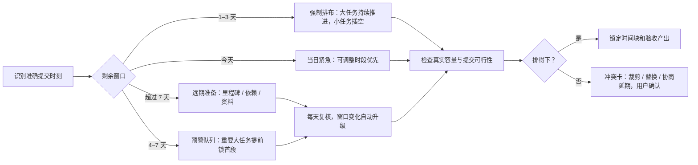
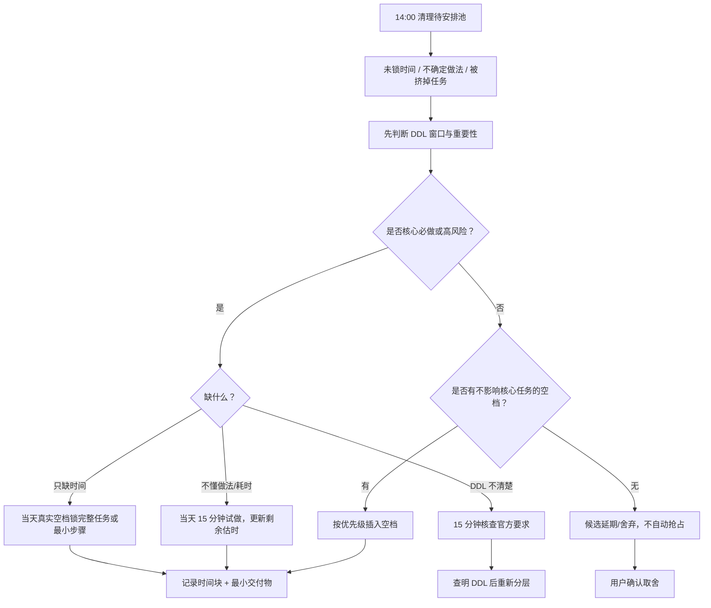

# 上岸鸭智能排期：DDL、待安排插空与反死磕流程图

> 三者关系：DDL 决定何时必须启动；14:00 只负责清理待安排并锁定合适时间块；45/90 分钟机制负责止损。止损后只对剩余工作重新排期。

## 总流程

## DDL 三档排期规则

## 14:00 待安排任务插空规则

## 关键约束

- 7 天是预警与提前准备，不等于所有任务都必须今天做。
- 3 天是必做任务的强制排布窗口；大任务不能等到最后一天才启动。
- 14:00 是统一清理时点，不是所有不确定任务的强制执行时点；插空由重要性、DDL、工作量和依赖决定。
- 任务没有准确 DDL 时必须明确标“未知”，不能编造日期；重要必做项先安排核查。
- 每日管理会计 40 分钟作为刚性容量保护项，允许紧急暂停，尽力当天补足；计时和学习成果分开验收。
- 估时 30 分钟的任务，累计执行 45 分钟无新产出触发诊断；同一卡点累计实际执行 90 分钟强制停止当前做法。
- 90 分钟按同一卡点累计，跨番茄钟、暂停、突发中断和重启不清零；固定事务开始时刻可以更早截停。
- 止损后只对未完成的剩余工作重新估时、拆解和排期；已完成部分不重复排。
- 取舍只给建议，删除/舍弃由用户确认；确认舍弃后保留 24 小时恢复期。
